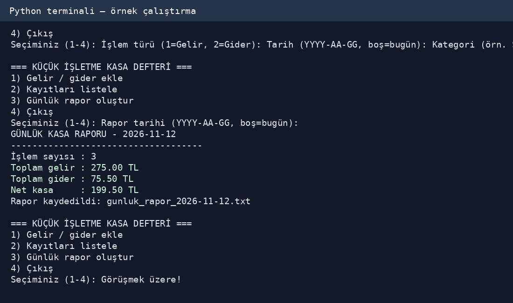

# Küçük İşletme Kasa Defteri ve Günlük Rapor

GEP1316 Kodlama Okuryazarlığı – Ara Değerlendirme Ödevi 1 | 2026–2027 Güz

## Ne yapar?
Komut satırından gelir/gider işlemlerini kaydeder, eski kayıtları görüntüler ve belirli bir gün için toplam gelir, toplam gider, net kasa ve işlem sayısını hesaplar. İşlemler `kasa_kayitlari.csv` dosyasında tutulur; günlük rapor `gunluk_rapor_YYYY-AA-GG.txt` dosyasına kaydedilir.

## Gereksinimler ve çalıştırma
Python 3 gerekir; ek paket kurulumu gerekmez.

```bash
python kasa_defteri.py
```

Menü: `1` gelir/gider ekle, `2` listele, `3` günlük rapor, `4` çıkış. Tür için `1`/`2`; tarih için `YYYY-AA-GG` veya boş (bugün); kategori için boş olmayan metin; tutar için `125,50` gibi sıfırdan büyük ve en fazla iki ondalıklı sayı girilir. Açıklama isteğe bağlıdır. Hatalı girişte tekrar sorulur.

## Örnek
2026-11-12 tarihine 250 TL gelir, 25 TL gelir ve 75,50 TL gider girildiğinde aynı güne ait raporda toplam gelir 275 TL, toplam gider 75,50 TL ve net kasa 199,50 TL olur. Aynı güne ait olmayan işlemler bu günlük toplamı değiştirmez.

## Ekran görüntüleri


*Görsel, gerçek programın örnek verilerle çalıştırılması sonucu elde edilen terminal metninin görselleştirilmesidir.*

## Kontrol edilen testler
10 testin tamamı geçti: virgüllü tutar, sıfır tutar reddi, üç ondalık reddi, geçersiz tarih, geçerli tarih, farklı gün kayıtlarının dışlanması, kayıtsız gün, yanlış menü seçimi, TXT oluşturma, art arda hatalı girişlerden sonra doğru giriş.

## Dosyalar
- `kasa_defteri.py`: uygulama kodu
- `README.md`: açıklamalar, talimatlar ve ekran görüntüsü
- `PROMPTLAR.md`: YZ kullanımına ilişkin kontrol edilmesi gereken örnek istemler
- `ekran_goruntusu.png`: örnek terminal çıktısı
- `GEP1316_Odev1_NihalTarhan_Rapor.pdf`: süreç raporu

**Önemli:** `PROMPTLAR.md` içindeki örnek istemler birebir geçmiş konuşma kaydı değildir. Teslim öncesinde gerçek istemlerin ve müdahalelerinle değiştir. Kişisel verileri kamuya açık GitHub deposuna koyma.
